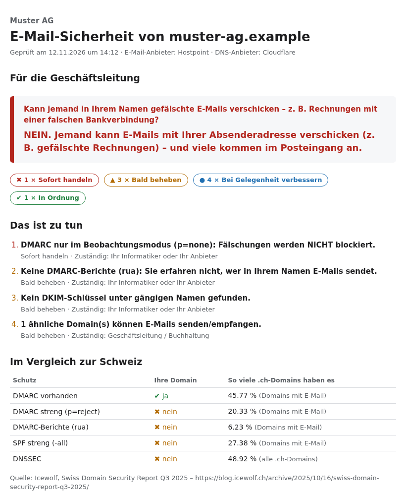

# pruefstand

**Kann jemand in Ihrem Namen gefälschte E-Mails verschicken – z. B. Rechnungen mit einer falschen Bankverbindung?**

`pruefstand` prüft eine Domain **passiv** – nur über öffentliche DNS-Daten – und erstellt
einen Bericht auf Deutsch: eine Seite für die Geschäftsleitung in einfacher Sprache,
danach die technischen Details für den Informatiker, mit Anleitung für den jeweiligen
Anbieter (Hostpoint, Infomaniak, Cloudflare, Microsoft 365).

Gedacht für KMU und für IT-Dienstleister, die KMU betreuen.



*Beispielbericht mit erfundenen Daten – [ganzer Bericht](beispiel/muster-ag.html).*

## Was wird geprüft?

| Prüfung | Frage |
|---|---|
| NS / MX | Wo liegt Ihr DNS, wer nimmt Ihre E-Mails an? |
| SPF | Welche Server dürfen in Ihrem Namen senden? (inkl. 10-Lookup-Grenze) |
| DMARC | Werden gefälschte E-Mails blockiert? Bekommen Sie Berichte? |
| DKIM | Sind Ihre E-Mails digital unterschrieben? |
| DNSSEC | Sind Ihre DNS-Antworten signiert? |
| CAA | Wer darf TLS-Zertifikate für Ihre Domain ausstellen? |
| MTA-STS / TLS-RPT | Wird die Verschlüsselung eingehender E-Mails erzwungen? |
| Sperrlisten (DNSBL) | Steht Ihr Mailserver auf einer Spam-Liste? |
| Webseite | Zertifikat (Ablauf), HTTPS, HSTS, Sicherheits-Header, security.txt |
| Ähnliche Domains | Hat jemand «mu5ter-ag.ch», «müster-ag.ch» oder «muster-ag.com» mit E-Mail registriert? |

Dazu: **Vergleich mit allen .ch-Domains** (Icewolf, Q3 2025) und **Verlauf**: Bei jeder
weiteren Prüfung zeigt pruefstand, was seit dem letzten Mal neu kaputt oder behoben ist.

## Installation

```bash
pipx install git+https://github.com/chilaba8/pruefstand
```

Für PDF-Berichte wird Chromium benötigt (sonst HTML im Browser «Als PDF drucken»).

## Verwendung

```bash
pruefstand beispiel.ch                       # Ergebnis im Terminal
pruefstand info@beispiel.ch                  # E-Mail- oder Web-Adresse geht auch
pruefstand beispiel.ch --pdf bericht.pdf --firma "Beispiel AG"
pruefstand beispiel.ch --json                # für Skripte
```

### Für IT-Dienstleister: alle Kunden auf einmal, mit eigenem Logo

```bash
# kunden.txt – eine Domain pro Zeile, optional mit Firmenname
#   beispiel.ch;Beispiel AG
#   muster.ch
pruefstand --liste kunden.txt --ordner berichte --mit-pdf \
           --absender "Ihre IT GmbH" --logo logo.png
```

Ergebnis: ein Bericht pro Kunde, `uebersicht.html` (dringendste zuerst) und
`uebersicht.csv` (öffnet direkt in Excel).

Weitere Optionen:

| Option | Wirkung |
|---|---|
| `--sprache de-DE` | Rechtschreibung für Deutschland (ß, „…“); Standard ist `de-CH` |
| `--ohne-web` | nur DNS, Webseite und MTA-STS-Datei nicht abrufen |
| `--ohne-aehnliche` | Suche nach ähnlichen Domains überspringen |
| `--online-quellen` | ähnliche Domains zusätzlich bei RDAP (Registrierdatum) und crt.sh (Zertifikate) nachschlagen – langsam, sendet diese Domainnamen an externe Dienste |
| `--ohne-verlauf` / `--verlauf ORDNER` | Vergleich mit früheren Prüfungen aus / anderer Ordner |
| `--dkim-selektor NAME` | zusätzlichen DKIM-Selektor prüfen |

Rückgabewert: `0` alles gut · `1` Warnungen · `2` kritische Befunde · `3` Fehler.

## Datenschutz

- Abgefragt werden öffentliche DNS-Daten und – wie bei jedem Besuch – die Startseite,
  `/.well-known/security.txt` und die MTA-STS-Datei. Kein Scan, kein Login.
- Sperrlisten werden per DNS gefragt (Spamhaus: frei für geringe, nicht-kommerzielle Nutzung).
- Externe Dienste (RDAP, crt.sh) nur mit `--online-quellen`.
- Der Verlauf bleibt auf Ihrem PC (`~/.local/share/pruefstand/verlauf`, nur für Sie lesbar).
- Der Bericht ist eine einzige Datei ohne externe Schriften oder Skripte.

## Grundsätze

- **Nie raten.** Kann etwas nicht geprüft werden (DNS-Fehler, unbekannter DKIM-Selektor),
  steht das im Bericht – statt eines falschen «fehlt» oder «alles gut».
- **Anleitungen nur aus offizieller Doku**, jeweils mit Quelle und Prüfdatum.

## Entwicklung

```bash
python3 -m venv .venv && .venv/bin/pip install -e '.[test]'
.venv/bin/pytest
.venv/bin/python beispiel/erzeuge_muster.py   # Beispielbericht neu erzeugen
```

## Lizenz

MIT
